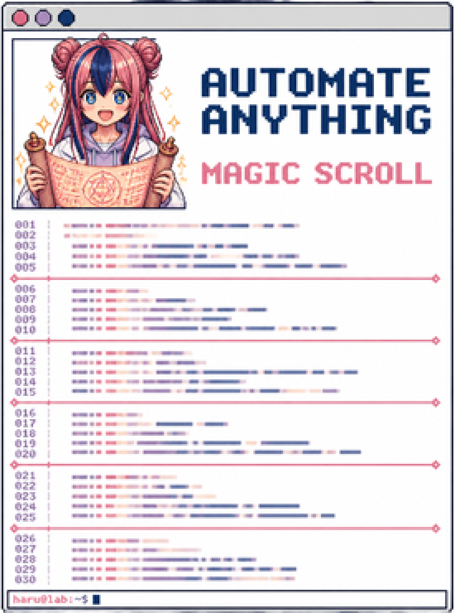
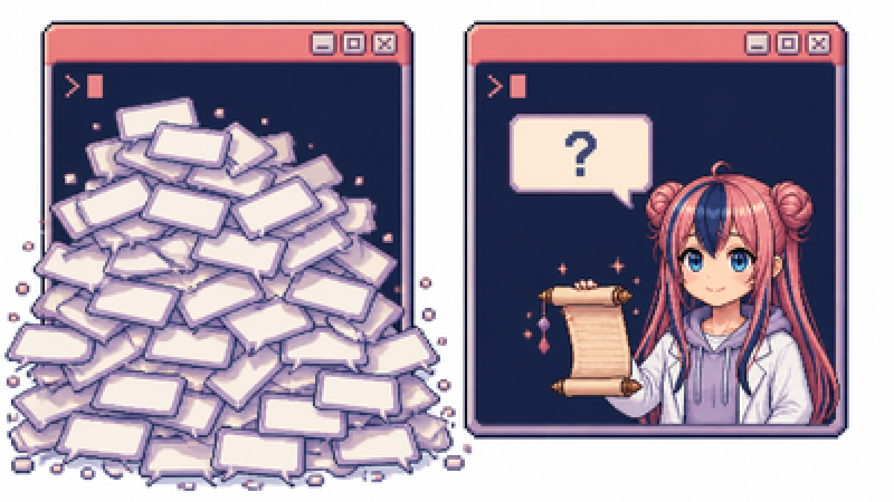

# Automate Prompt Lab — LLM의 마법 주문서

<p align="center"></p>

> **먼저 이해하고, 자동화는 그다음.**

Lauren Tan(poteto)의 "Automate Anything" 프롬프트(Grok Bot용)를 어떤 생성 AI에도 쓸 수 있게 한국어로 다시 만들고, 연구실 조수 **하루** 버전으로 실제 성능을 시연하는 저장소입니다.

- 원작: Lauren Tan(poteto), "Automate Anything"
- 재구성: 안상선 ((주)M-Robo 대표)

## 소개 페이지

`index.html` — 6단계 그림 해설, 주문서 복사 버튼, 시연 채점표가 들어 있습니다. GitHub Pages(main 브랜치 루트)로 공개합니다.

## 구성

| 경로 | 내용 |
|---|---|
| `index.html` | 소개 페이지 (흰 배경·픽셀아트, 주문서 복사 버튼, 시연 채점표) |
| `scrolls/magic_scroll_automate_anything_news_ko.md` | 주문서 한국어판 — 하루판·뉴스 분석편 |
| `tools/google_news_rss.py` | 구글 뉴스 RSS 수집기 (CSV + AI 붙여넣기용 md) |
| `tools/google_news_rss_colab.ipynb` | 같은 수집기의 Colab 노트북판 — 실행 후 md 파일 내려받기 |
| `images/` | 하루 픽셀아트 그림 11장 (Genspark 제작) — 표지·초상·6단계 장면·시연 비교 |
| `samples/news_20261124_0148.md` | 수집 예시 — 키워드 "인공지능", 최근 1일, 98건 |

## 주문서 6단계

| | 단계 | 하루가 하는 일 |
|---|---|---|
|  | **1. 목표 먼저** | 최종 목표를 정하고, 매출 쪽인지 비용 쪽인지 가린다 |
|  | **2. 과정 쏟아내기** | 지저분하게 쏟아낸 말을 받아 정리한다 (실행은 보류) |
|  | **3. 내 판단 방식** | 한 번에 하나씩 묻고, 충돌 규칙과 완료의 정의를 정한다 |
|  | **4. 스스로 개선** | 피드백을 기록과 맞춰 빈틈을 찾는다 |
|  | **5. 루틴** | 시간·메시지·일정을 계기로 반복한다 |
|  | **6. 검토** | 목표와 비교해 더 나은 방법을 제안하고 승인을 기다린다 |

## 시연 1: 구글 뉴스 RSS 분석

<p align="center"></p>

```bash
pip install feedparser
python tools/google_news_rss.py 인공지능 --days 1
```

만들어진 `news_*.md`를 주문서와 함께 AI에 붙여 넣습니다. 같은 입력으로 여러 AI(Claude·ChatGPT·Gemini 등)를 비교하고, 주문서를 쓴 경우와 안 쓴 경우를 나란히 봅니다.

**채점 기준**: 질문 횟수 · 실행 보류 여부 · 완료 정의 확인 여부 · 최종 결과물 5종(목표·과정·규칙·루틴·다음 단계) 충족 여부

> 기사 원문은 옮기지 않습니다. 제목·매체·날짜·링크만 다룹니다.
